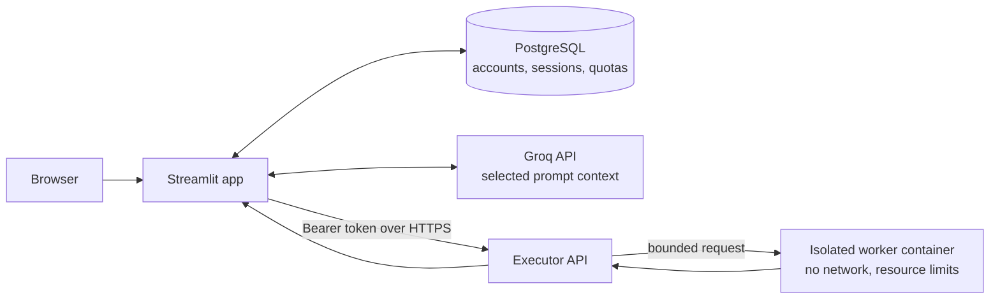
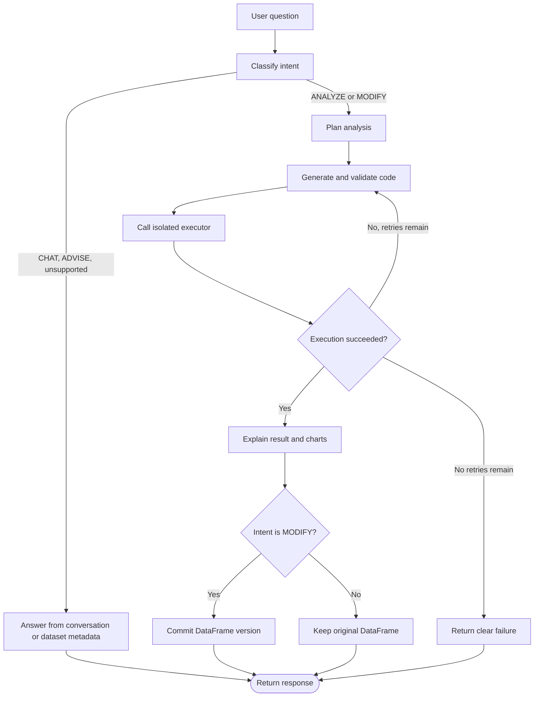
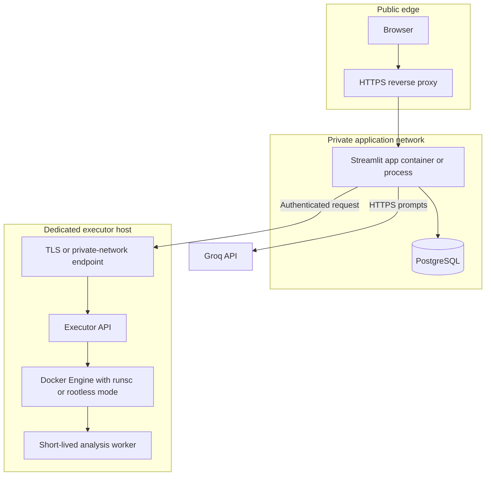

# AI Data Analyst

AI Data Analyst is a Streamlit application for exploring CSV and Excel datasets with natural-language questions. It uses PostgreSQL for accounts and session records, Groq for language-model tasks, and a separately operated isolated worker for generated Python analysis.

## What it does

- Upload and inspect CSV/XLSX tables, review schema and data-quality summaries, and optionally join related tables.
- Ask questions for analysis, visualization, dataset-grounded advice, or supported dataset changes.
- Run generated analysis code in a separate worker container with resource limits and no network access.
- Render interactive Plotly charts, inspect computation details, download a dataset snapshot, or export a notebook.
- Register and sign in using PostgreSQL-backed accounts. Registration can be restricted with an invite code.

The service does not train or deploy machine-learning models. Its recommendations are guidance based on the metadata provided; they are not evidence that a model was trained or evaluated.

## Architecture



The app does not mount the host Docker socket. The executor service must run on a dedicated host with a verified rootless Docker setup or the gVisor `runsc` runtime. A plain subprocess is not a security boundary. See [Deployment](docs/DEPLOYMENT.md) and [Security and privacy](docs/SECURITY.md).

### Request and analysis flow



Only successful modification requests commit a new DataFrame version. Ordinary analysis results and direct advice do not alter the active dataset.

### Deployment topology



The executor host is separate from the app and database. Keep its API private, and never mount the Docker socket into the Streamlit app. See [Deployment](docs/DEPLOYMENT.md) for host setup and network controls.

## Quick start (Windows / Conda)

Prerequisites: Python 3.12, PostgreSQL, a Groq API key, and an independently configured executor service. The app deliberately fails closed if the executor is unavailable.

1. Create the database and apply the versioned migration as described in [Database setup](docs/DEPLOYMENT.md#postgresql-setup).
2. Copy `.env.example` to `.env` and fill in `GROQ_API_KEY`, `DATABASE_URL`, `ANALYSIS_EXECUTOR_URL`, and `ANALYSIS_EXECUTOR_TOKEN`. Do not commit `.env`.
3. Install and launch:

   ```powershell
   conda create -n agentic python=3.12 -y
   conda activate agentic
   python -m pip install -r requirements.txt
   streamlit run app.py
   ```

4. Open the local URL printed by Streamlit, create an account, and upload a CSV or XLSX file.

For a local-only executor development setup, see [Deployment: executor setup](docs/DEPLOYMENT.md#executor-service). Production requires `runsc` or rootless Docker; do not use the CI-only `EXECUTOR_CI_ALLOW_RUNC` override in deployment.

## Docker images in this repository

There are two separate images:

| Image | Build file | Purpose | Needed by |
|---|---|---|---|
| `ai-data-analyst:local` | `Dockerfile` | Streamlit web app | App deployment; not required when running Streamlit directly in Conda |
| `ai-data-analyst-executor:latest` | `Dockerfile.executor` | Isolated generated-code worker | Executor host; required by the executor API |

The executor service references `ai-data-analyst-executor:latest` by default. No project container is currently running, based on the Docker check performed for this documentation update. Keep the executor image if you want analyses to execute. The app image can be removed if you only run the app from Conda and do not need the container build; Docker can rebuild it later.

The repository does not include a Compose file. The app and executor are separate services and must not share the Docker socket. Build commands and production configuration are in [Deployment](docs/DEPLOYMENT.md).

## Configuration

See [.env.example](.env.example) for the supported app settings. Main settings:

| Variable | Purpose |
|---|---|
| `GROQ_API_KEY` | Groq credential. Keep it only in the app's secret store or protected environment. |
| `GROQ_MODEL` | Groq model identifier; defaults to `openai/gpt-oss-20b`. |
| `DATABASE_URL` | PostgreSQL connection for the least-privilege runtime account. |
| `ANALYSIS_EXECUTOR_URL` | Base URL of the executor API. Production should use HTTPS. |
| `ANALYSIS_EXECUTOR_TOKEN` | Shared app-to-executor bearer secret, at least 32 characters. |
| `ANALYSIS_EXECUTOR_TIMEOUT` | App-side executor request timeout, bounded by the client implementation. |
| `MAX_DATASET_PARQUET_BYTES` | Optional cap on the normalized in-memory dataset representation. |
| `DAILY_ANALYSIS_LIMIT` | Per-account daily analysis quota. |
| `SIGNUP_INVITE_CODE` | Optional invite-only registration secret; blank permits open sign-up. |

Executor settings are documented in [Deployment](docs/DEPLOYMENT.md#executor-service). Never paste secret values into issue reports or logs.

## Data handling overview

- Uploads are limited to 20 MB per file, CSV/XLSX, at most 500,000 rows and 200 columns; converted Parquet data is capped at 16 MB by default.
- Tier 0 shares schema, types, shape, and the question with Groq. Tier 1 also shares a local aggregate profile. Tier 2 may include up to three sample rows and computed output. Choose the lowest tier suitable for your data.
- Successful modification requests commit a new session DataFrame version. Analysis requests do not commit generated mutations. The app keeps up to five prior versions for undo and supports restoring the uploaded snapshot.
- Session datasets live in Streamlit session state; they are not durable database records. A browser refresh or server restart can end a session.
- Notebook export includes code and metadata needed for the workflow, but not dataset values or execution output. Place the separately downloaded dataset beside the notebook before running it.

Read [Security and privacy](docs/SECURITY.md) before handling sensitive data.

## Development and verification

```powershell
conda activate agentic
python -m pip install -r requirements-dev.txt
python -m pytest -q
python -m ruff check app.py src executor_service tests
```

Executor integration tests require Docker and the worker image. They are environment-dependent; unit tests mock the external model and executor where appropriate. See [Development](docs/DEVELOPMENT.md).

## Documentation

- [Deployment guide](docs/DEPLOYMENT.md): database migration, image builds, runtime configuration, reverse proxy, health checks, and upgrades.
- [Security and privacy](docs/SECURITY.md): trust boundaries, dataset sharing, executor isolation, and operational safeguards.
- [Development guide](docs/DEVELOPMENT.md): environment setup, tests, linting, and contribution workflow.
- [Operations guide](docs/OPERATIONS.md): startup, health checks, backups, logs, and troubleshooting.
- [Improvement plan](IMPROVEMENT_PLAN.md): broader project roadmap and planned work; items there are not necessarily implemented.

## Current limitations

- Email verification and password recovery are not implemented.
- PostgreSQL stores accounts, login/session metadata, and usage counts, not uploaded datasets.
- A production-ready executor requires operator-provisioned `runsc` or rootless Docker and TLS/network controls; a Docker image alone does not provide the complete isolation boundary.
- Model recommendations are advisory; the system does not automatically train, validate, or deploy a model.
- Supported formats are CSV and XLSX; multi-sheet Excel imports are treated as separate tables where supported by the upload flow.
